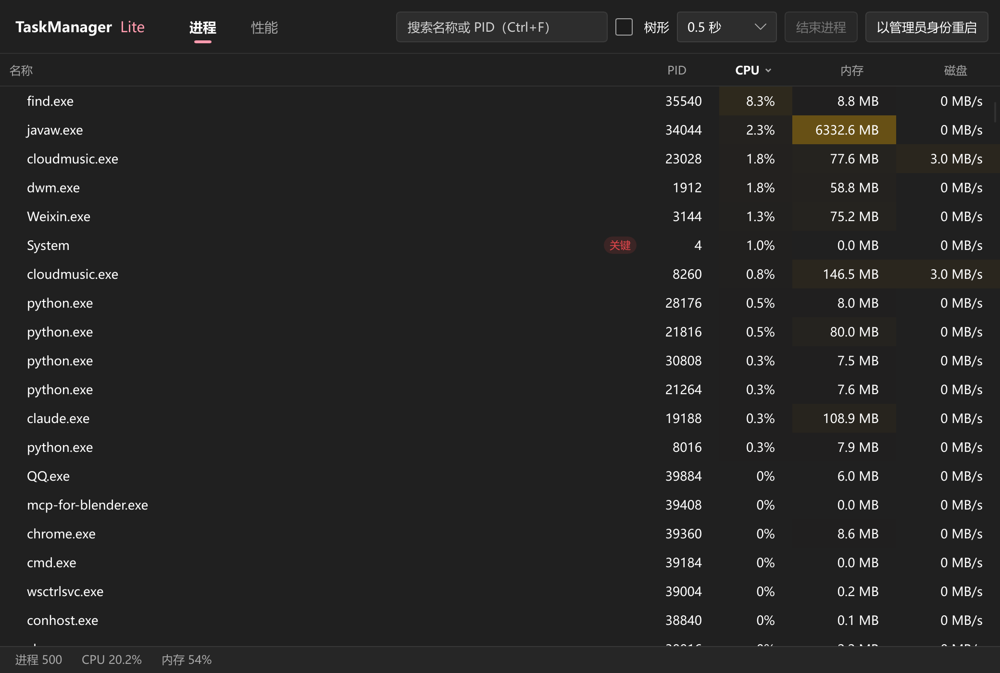
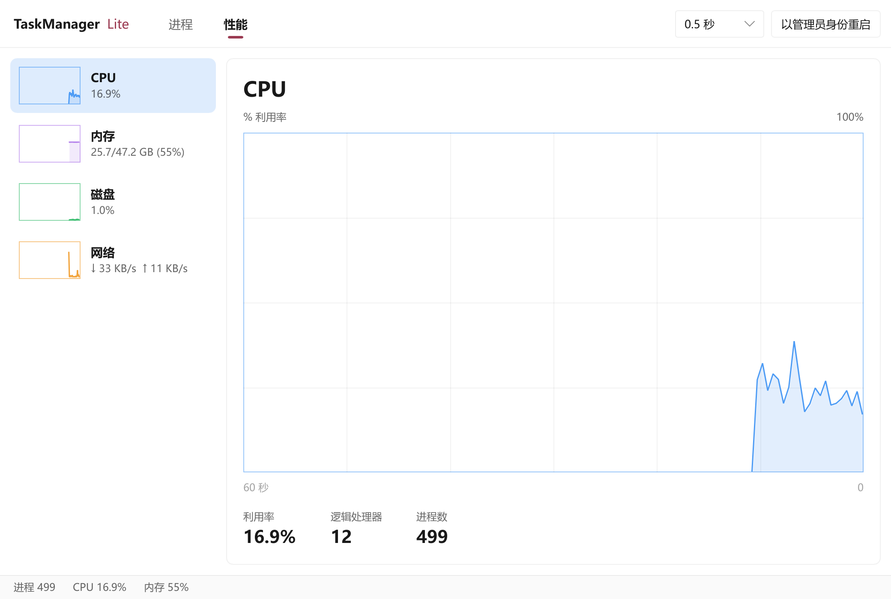

# TaskManagerLite

用 Rust + [Slint](https://slint.dev) 重写的 Windows 任务管理器，目标是冷启动快、常驻开销低、界面美观。




## 功能

- **进程列表**：排序、搜索、进程图标、进程树视图、按“应用 / 后台进程”分组；可结束进程或整棵进程树。
- **右键菜单**：打开文件位置、复制路径与命令行、查看属性、在线搜索。
- **性能概览**：CPU、内存、磁盘、网络的资源曲线；CPU 详情页含逻辑处理器视图，内存详情页含物理内存组成与提交信息。
- **按需提权**：默认以普通权限启动，不弹 UAC；需要查看或结束受保护的进程时再以管理员身份重启。
- **轻量常驻**：采样间隔可调（0.5 / 1 / 2 秒或暂停），窗口不可见时停止采样；只允许运行一个实例。
- **设置持久化**：窗口位置与大小、列宽等保存在 `%APPDATA%\TaskManagerLite\settings.json`。

启动耗时与常驻开销的实测数据见 [ADR 0002](docs/adr/0002-software-renderer-default.md)。

## 下载

从 [GitHub Releases](https://github.com/djp440/TaskManagerLite/releases) 下载 `TaskManagerLite-<版本>.exe`，同目录下的 `.sha256` 文件可用于校验。无需安装，直接运行。

## 从源码构建

需要 Windows 和 stable Rust 工具链。

```sh
# 默认 software 渲染
cargo build -p tml-app --release

# femtovg（OpenGL）渲染
cargo build -p tml-app --release --no-default-features --features renderer-femtovg

# 测试
cargo test -p tml-core -p tml-app
```

产物为 `target/release/TaskManagerLite.exe`。

## 项目结构

- `crates/core`（`tml-core`）：采集进程快照与系统级指标、构建进程树、结束进程，纯 Rust，可脱离界面单测。
- `crates/app`（`tml-app`）：Slint 界面与采样线程。
- `scripts/`：启动耗时、常驻开销测量与截图等验收脚本。
- `docs/adr/`：架构决策记录；`docs/checklist/`：人工验收清单。
- `GLOSSARY.md`：领域术语。

## 许可证

本项目以 [MIT 许可证](LICENSE) 发布。

界面基于 Slint 构建，按 [Slint Royalty-free License 2.0](https://github.com/slint-ui/slint/blob/master/LICENSES/LicenseRef-Slint-Royalty-free-2.0.md) 使用：

[](https://slint.dev)
